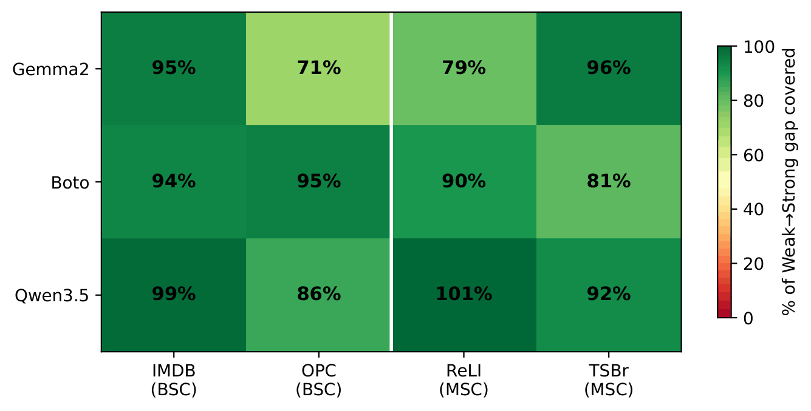
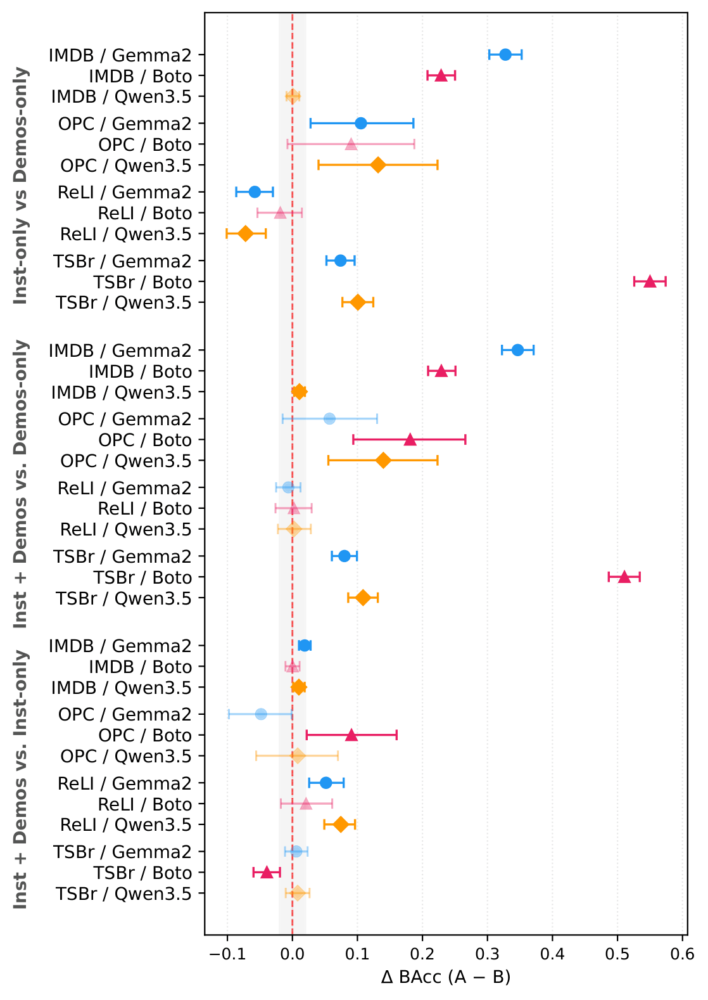
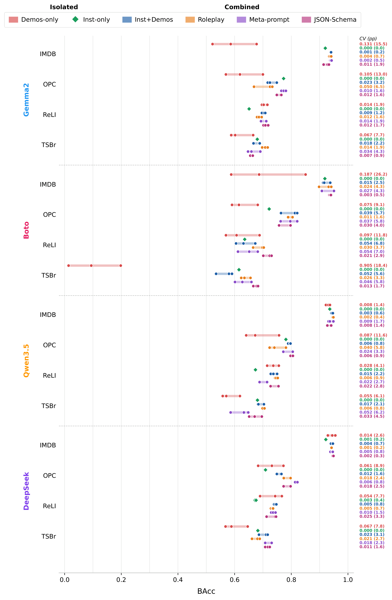
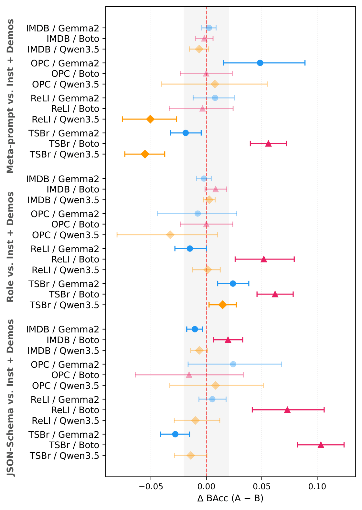

# Prompt Engineering for Small Language Models: Evaluating In-Context Learning for Portuguese Sentiment Analysis

> **Paper:** _Prompt Engineering for Small Language Models: Evaluating In-Context Learning for Portuguese Sentiment Analysis_ — Under review at STIL 2026

---

## Abstract

The In-Context Learning (ICL) paradigm enables adapting Large Language Models (LLMs) to specific tasks without parameter tuning. This paper investigates the influence of prompt engineering on 9B-parameter LLMs for Brazilian Portuguese sentiment classification, evaluating six formats, i.e., Few-Shot and Zero-Shot prompting across three linguistically diverse models: English-dominant (Gemma2-9B-it), PT-BR fine-tuned (Boto-9B-IT), and multilingual (Qwen3.5-9B). The analysis is conducted across four public datasets spanning binary and multiclass tasks, anchored to two baselines: a fine-tuned encoder (MSA-DistilBERT, ~0.1B) as a performance floor and DeepSeek-V3.2 (685B, MoE) as a ceiling reference, evaluated under the same protocol. Results show that, under their best prompt, all 9B models surpass the fine-tuned encoder and cover 71–101% of the weak-to-strong baseline gap, with Qwen3.5-9B achieving the highest mean coverage (94.5%). Paired bootstrap tests reveal that well-defined instructions are the primary driver of ICL performance, capturing most of the accuracy achievable by combined formats even in a zero-shot setting. The discussions offer practical guidance for deploying SLMs in resource-constrained PT-BR NLP scenarios.

---

## Research Questions

- **RQ1:** Where do 9B-parameter models under ICL sit between a fine-tuned encoder baseline (~0.1B) and a state-of-the-art 685B model? Does prompt sensitivity persist at larger scales?

- **RQ2:** Do instructions and demonstrations make distinct contributions to ICL performance for PT-BR SA with 9B-parameter models, and does combining both components outperform either in isolation?

- **RQ3:** Among combined instruction-demonstration formats for 9B-parameter models, does increasing prompt elaboration yield statistically significant gains over the simplest combined baseline, or do these formats exhibit practical equivalence?

---

## Key Contributions

1. A controlled evaluation of six prompt engineering formats, spanning few-shot and zero-shot paradigms, across three linguistically diverse 9B-parameter SLMs for PT-BR SA — anchored by a fine-tuned encoder (~0.1B) and a 685B MoE model as baselines evaluated under the same protocol.

2. Evidence that 9B-parameter SLMs can approach the predictive performance of a model an order of magnitude larger (685B), covering 71–101% of the weak-to-strong baseline gap, with Qwen3.5-9B achieving the highest mean coverage (94.5%).

3. Empirical evidence that well-constructed instructions — explicitly encoding task definition, label space, and expected output format — are the primary driver of ICL performance. Zero-shot instructions alone capture most of the accuracy achievable by combined formats, whereas demonstrations in isolation risk substantial degradation.

---

## Key Findings

### RQ1 — Positioning 9B SLMs in the capability landscape

All three 9B models surpass the fine-tuned encoder baseline under their best prompt and cover a substantial portion of the weak-to-strong performance gap. Qwen3.5-9B achieves the highest mean coverage at **94.5%**, essentially matching the 685B model's robustness to prompt variation.



_Coverage (%) of the weak-to-strong baseline gap per model and dataset. DeepSeek-V3.2 (685B) serves as the strong ceiling; MSA-DistilBERT (~0.1B fine-tuned) as the weak floor._

---

### RQ2 — Instructions vs. Demonstrations

Instructions alone outperform demonstrations alone in **7 of 12** model–dataset comparisons (paired bootstrap, p < 0.05), with a mean ΔBAcc of **+0.122** favoring the Inst-only format. Adding demonstrations to instructions yields only a marginal gain (+0.017 mean ΔBAcc). Critically, instructions **reduce ordering sensitivity by 3.9× on average**, shrinking the BAcc range from 9.6 pp (Demos-only) to 2.5 pp (Inst+Demos).




_Forest plot of paired bootstrap effect sizes (ΔBAcc) for Inst-only vs. Demos-only (top), Inst+Demos vs. Demos-only (middle), Inst+Demos vs. Inst-only (botton). Dark markers indicate p < 0.05; gray markers p ≥ 0.05._



_Balanced accuracy across three demonstration orderings for each format, model, and dataset. Isolated formats (Demos-only) exhibit wide variance; instruction-anchored formats collapse to narrow variance._

---

### RQ3 — Does prompt elaboration pay off?

Elaborated formats (Meta-prompt, Roleplay, JSON-Schema) yield mean ΔBAcc differences of −0.001, +0.009, and +0.012 respectively over the simplest combined baseline (Inst+Demos) — none statistically consistent. The results support a **principle of prompt parsimony**: well-defined zero-shot or minimal few-shot instructions are sufficient, and additional elaboration does not reliably improve performance.




_Forest plot comparing JSON-Schema, Roleplay, and Meta-prompt against Inst+Demos. Confidence intervals for most comparisons span zero, indicating practical equivalence._

---

## Experimental Scale

| Dimension                   | Value                                                    |
| --------------------------- | -------------------------------------------------------- |
| Total individual inferences | **337,479**                                              |
| SLMs evaluated              | 3 (Gemma2-9B-it, Boto-9B-IT, Qwen3.5-9B)                 |
| Baselines                   | 2 (MSA-DistilBERT ~0.1B weak; DeepSeek-V3.2 685B strong) |
| PT-BR datasets              | 4 (IMDB-PT, OpCovidBR, ReLI, TweetSentBR)                |
| Prompt templates            | 6 (zero-shot to elaborated few-shot)                     |
| Inference rounds per config | 3 (distinct demonstration orderings)                     |
| Statistical test            | Paired bootstrap (B = 10,000, α = 0.05)                  |

---

## Repository Structure

```
.
├── Article/
│   └── Images/                # Figures used in the paper
├── Notebooks/
│   ├── 01 - datasets_preprocessing.ipynb       # Dataset download and preprocessing
│   ├── 02 - demonstration_selection.ipynb       # Few-shot demonstration selection via K-means
│   ├── 03 - evaluation_deepseek-v3.2.ipynb      # Evaluation: DeepSeek-v3.2 (strong baseline)
│   ├── 04 - evaluation_gemma2-9b.ipynb          # Evaluation: Gemma 2 9B-it
│   ├── 05 - evaluation_qwen3.5-9b.ipynb         # Evaluation: Qwen 3.5-9B
│   ├── 06 - evaluation_boto-9b-it.ipynb         # Evaluation: Boto-9B-it
│   ├── 07 - evaluation_multilingual-sentiment-analysis.ipynb  # Evaluation: weak baseline
│   └── 08 - Paired bootstrap majority vote.ipynb # Statistical analysis and results
├── Data/
│   ├── preprocessed/      # Stratified train/test splits (CSV)
│   ├── prompts_templates/ # Six Jinja2 prompt templates
│   ├── results/           # Model prediction CSVs (one per model/dataset/template/round)
│   └── staging_area/      # Inference checkpoints
├── .env.example           # Environment variable template
├── pyproject.toml
└── README.md
```

---

## Setup

**Prerequisites**: Python 3.13, [uv](https://docs.astral.sh/uv/)

```bash
# Clone and install dependencies
git clone <repository-url>
cd slm_prompt_analysis
uv sync
```

**Configure environment variables** — copy `.env.example` to `.env` and fill in your paths:

```bash
cp .env.example .env
```

```dotenv
AP_DATA_PREPROCESSED=Data/preprocessed
AP_DATA_RESULTS=Data/results
AP_PROMPTS_TEMPLATE=Data/prompts_templates
AP_STAGIN-AREA_PATH=Data/staging_area
HF_TOKEN=your_huggingface_token_here        # required for HF-hosted models
DEEPSEEK_API_KEY=sk-your-api-key-here       # required for notebook 03 only
```

---

## Notebooks

| #   | Notebook                                     | Description                                                                                                                                                                               |
| --- | -------------------------------------------- | ----------------------------------------------------------------------------------------------------------------------------------------------------------------------------------------- |
| 01  | `datasets_preprocessing`                     | Downloads IMDB-PT, OpCovidBR, ReLI, TweetSentBR from HuggingFace/GitHub; standardizes columns to `text`/`label`; performs 80/20 stratified splits.                                        |
| 02  | `demonstration_selection`                    | Generates text embeddings via Jina-embeddings-v3; applies K-means clustering; samples one representative example per cluster per label for balanced few-shot demonstrations.              |
| 03  | `evaluation_deepseek-v3.2`                   | Async inference via DeepSeek API for all dataset/template/round combinations. Serves as the strong baseline.                                                                              |
| 04  | `evaluation_gemma2-9b`                       | Inference via HuggingFace `pipeline` for Gemma 2 9B-it. Requires GPU.                                                                                                                     |
| 05  | `evaluation_qwen3.5-9b`                      | Inference for Qwen 3.5-9B. Requires GPU.                                                                                                                                                  |
| 06  | `evaluation_boto-9b-it`                      | Inference for Boto-9B-it (Brazilian Portuguese-tuned model). Requires GPU.                                                                                                                |
| 07  | `evaluation_multilingual-sentiment-analysis` | Inference for a multilingual zero-shot classifier. Serves as the weak baseline.                                                                                                           |
| 08  | `Paired bootstrap majority vote`             | Consolidates 3-round predictions via majority vote; runs bilateral paired bootstrap tests to compare prompting strategies; outputs `consolidation_stats.csv` and `bootstrap_results.csv`. |

**Execution order**: 01 → 02 → 03–07 (independent) → 08

---

## Datasets

| Dataset                                                                       | Source      | Task                 | Labels                      |
| ----------------------------------------------------------------------------- | ----------- | -------------------- | --------------------------- |
| [IMDB-PT](https://huggingface.co/datasets/maritaca-ai/imdb_pt)                | HuggingFace | Binary sentiment     | -1 (Negative), 1 (Positive) |
| [OpCovidBR](https://github.com/t-davidson/hate-speech-and-offensive-language) | GitHub      | Binary sentiment     | -1 (Negative), 1 (Positive) |
| [ReLI](https://huggingface.co/datasets/ruanchaves/reli)                       | HuggingFace | Multiclass sentiment | -1, 0 (Neutral), 1          |
| [TweetSentBR](https://huggingface.co/datasets/ruanchaves/tweetsentbr)         | HuggingFace | Multiclass sentiment | -1, 0 (Neutral), 1          |

**Label encoding**: `-1` = Negative, `0` = Neutral, `1` = Positive

---

## Prompt Templates

Six Jinja2 templates in `Data/prompts_templates/`, referenced in the paper by the following names:

| Name       | File                                                       | Strategy                                                  |
| ---------- | ---------------------------------------------------------- | --------------------------------------------------------- |
| Inst-only  | `template-task-specific-instructions-zero-shot.jinja`      | Zero-shot with task-specific instructions                 |
| Inst+Demos | `template-task-specific-instructions-few-shot.jinja`       | Few-shot with task-specific instructions + demonstrations |
| Demos-only | `template-task-agnostic-no-instructions-few-shot-en.jinja` | Few-shot with demonstrations only (no instructions)       |
| Roleplay   | `template-task-specific-roleplay-few-shot.jinja`           | Few-shot with role-play framing                           |
| Meta       | `template-task-specific-meta-prompt-few-shot.jinja`        | Few-shot with automated meta-prompt instructions          |
| JSON       | `template-task-specific-instructions-few-shot-json.jinja`  | Few-shot with structured JSON output format               |

---

## Implementation Details

| Aspect                    | Detail                                                                  |
| ------------------------- | ----------------------------------------------------------------------- |
| Hardware                  | NVIDIA A100 (40 GB) via Google Colab                                    |
| Precision                 | BFloat16                                                                |
| Decoding                  | Greedy (do_sample=False), max_new_tokens=10 (20 for JSON)               |
| Demonstration embeddings  | jina-embeddings-v3 + K-means (k=3 per label)                            |
| Demonstrations per prompt | 6 (3 per class for binary; 2 per class for multiclass)                  |
| Prediction consolidation  | Majority vote across 3 orderings; ties → Format Non-Compliance (code 2) |
| Output parsing            | Format-specific regex; 3-layer cascaded strategy for non-JSON formats   |
| Random seeds              | Subsampling/selection: s=42; orderings: s ∈ {42, 2, 3}                  |

---

## Citation

```bibtex
@article{anonymous2026prompt,
  title   = {Prompt Engineering for Small Language Models: Evaluating
             In-Context Learning for Portuguese Sentiment Analysis},
  year    = {2026},
  note    = {Under review}
}
```
